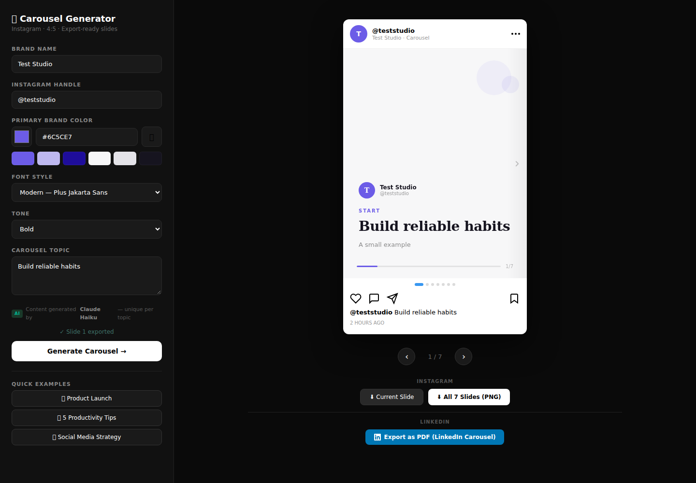

# Instagram Carousel Generator

[](https://github.com/Shilin237/instagram-carousel-generator/actions/workflows/ci.yml)

Turn a topic and brand palette into a swipeable carousel, then export individual 1080 × 1350 PNG slides or a multi-page PDF. The browser renders and exports the slides; a small Node function keeps the Anthropic key on the server.



## Features

* Brand colour, name, handle and font controls.
* AI-generated content with validated slide types and a sample fallback.
* Touch and keyboard navigation with a bounded final slide.
* Current-slide PNG, all-slide PNG and multi-page PDF downloads.
* Locally bundled export libraries and a restrictive script CSP.

## Quick start

Requires Node.js 22 or later and npm.

```sh
npm ci
cp .env.example .env
# Set ANTHROPIC_API_KEY for live generation.
npm run build
npm run dev
```

Open http://localhost:3200. Without a key, generation is unavailable and the UI offers sample content. `public/index.html` is the deployed application; the root `index.html` and `generator.html` are legacy standalone assets.

## Validation

```sh
npm test
npm run build
npx playwright install chromium
npm run test:e2e
```

Unit and integration tests validate inputs, palette generation, malformed provider output and rate-limit recovery. Playwright drives the real UI with a fixed seven-slide API fixture, downloads PNGs and checks their 1080 × 1350 dimensions, downloads all seven slides, checks last-slide navigation, and reads the resulting seven-page PDF. Provider calls and external fonts are mocked for deterministic tests; live model quality and font availability are separate checks.

## Architecture

| Path | Responsibility |
| --- | --- |
| `public/index.html`, `public/app.js` | UI, slide rendering, navigation and browser exports |
| `api/generate.js` | Anthropic adapter and server-owned generation prompt |
| `src/server/generate-handler.js` | Validation, error handling, request limits and test seam |
| `src/services`, `src/utils` | Reusable palette and validation utilities |
| `scripts/build.js` | Copy pinned export libraries from npm to public/vendor |
| `scripts/serve.js` | Local static server with the same generation handler |
| `tests/` | Executable Node tests and browser export checks |

The browser still owns its rendering and palette implementation; utility unit tests alone do not prove UI behaviour. Browser tests cover the actual deployed scripts.

## Deploy and limits

Import the repository into Vercel. Set `ANTHROPIC_API_KEY` and `ALLOWED_ORIGIN` to the deployed browser origin. Vercel uses `npm run build`, serves `public/` and executes `api/generate.js`.

This is a public demo with no user accounts. Its per-process rate limiter is a basic safeguard, not a global billing cap. Set provider spending limits and add shared rate limiting or access control before exposing an unrestricted paid deployment. CORS is not authentication. Review generated content and claims before publishing.

See [security and data handling](SECURITY.md), [contributing](CONTRIBUTING.md) and [change history](HISTORY.md).
